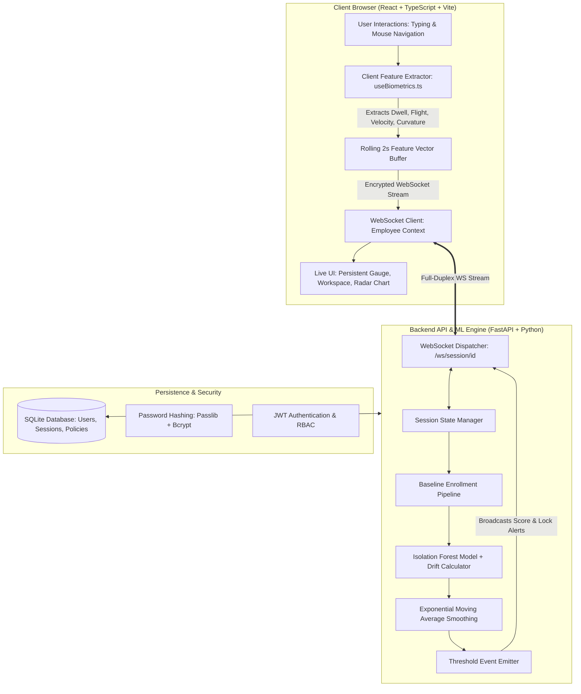

# 🛡️ TrustLoop: Continuous Authentication Using Behavioral Biometrics & Machine Learning

[](https://www.python.org/)
[](https://fastapi.tiangolo.com/)
[](https://reactjs.org/)
[](https://www.typescriptlang.org/)
[](https://vitejs.dev/)
[](LICENSE)

> **TrustLoop** is an enterprise-grade **Continuous Trust & Behavioral Biometric Authentication Platform**. It operates as an invisible, non-invasive security layer on top of traditional Multi-Factor Authentication (MFA), continuously verifying that the person actively interacting with an authenticated enterprise session is indeed the legitimate employee.

---

## 🌟 Key Highlights & Capabilities

- ⌨️ **Keystroke Dynamics Analysis**: Measures millisecond-level key dwell times (hold duration) and flight latencies (inter-key intervals).
- 🖱️ **Mouse Movement Kinematics**: Tracks trajectory velocity, acceleration curves, and angle variance (path curvature efficiency) in real time.
- 🧠 **Adaptive In-Memory Anomaly Engine**: Employs `scikit-learn` Isolation Forest combined with multi-dimensional relative drift scoring against personalized baseline profiles.
- 🔒 **Privacy-by-Design Architecture**: **Zero raw keystrokes or coordinates are ever transmitted or saved.** Only anonymized spatiotemporal statistical features computed client-side are streamed over encrypted WebSockets.
- 🌐 **Zero-Trust Network Context**: Integrates IP intelligence and ISP reputation profiling into the starting session trust allocation.
- 📊 **Real-Time Explainability & Telemetry**: Dynamic live score gauge, drift status indicators, feature contribution breakdowns, and multi-axis biometric fingerprint radar charts.
- 🏢 **Role-Based Enterprise Console**:
  - **Employee Workspace**: Realistic corporate email client and sprint Kanban board that naturally generate behavioral biometrics.
  - **Security Admin Console**: Real-time KPI monitors, organization activity stream, employee session inspector with remote simulation/termination controls, global network geo-map, audit logs with CSV export, and dynamic policy threshold sliders.

---

## 🏛️ System Architecture



---

## 💻 Tech Stack

### **Frontend**
- **Framework**: React 18 with TypeScript
- **Bundler**: Vite
- **Routing**: React Router v6 (Nested Layouts & Role-based routing)
- **Styling**: Modern Enterprise Light Theme (Tokens inspired by Stripe/Linear/Notion)
- **Charts & Visualizations**: Recharts (Radar, Area, Bar, Pie, Scatter Plots)
- **Icons**: Lucide React

### **Backend**
- **Framework**: FastAPI (Async ASGI)
- **Machine Learning**: `scikit-learn` (Isolation Forest), `NumPy`
- **Security & Cryptography**: `PyJWT`, `passlib` with `bcrypt`
- **Networking**: WebSockets (`websockets`), `requests` (IP Geolocation)
- **Database**: SQLite3 (Thread-safe connection pool)

---

## 🚀 Quick Start Guide

### Prerequisites
- **Python 3.10+**
- **Node.js 18+** & **npm**
- **Git**

---

### 1. Clone the Repository
```bash
git clone https://github.com/purvik-n/Continuous-Authentication-Using-Behavioral-Biometrics-and-Deep-Temporal-Models.git
cd Continuous-Authentication-Using-Behavioral-Biometrics-and-Deep-Temporal-Models
```

---

### 2. Backend Setup & Run

```bash
# Navigate to backend directory
cd backend

# Create virtual environment
python -m venv venv

# Activate virtual environment
# Windows (PowerShell):
.\venv\Scripts\Activate.ps1
# Windows (Command Prompt):
.\venv\Scripts\activate.bat
# Linux / macOS:
source venv/bin/activate

# Install dependencies
pip install -r requirements.txt

# Start FastAPI server on port 8000
uvicorn main:app --reload --port 8000
```
> The backend API will be live at `http://localhost:8000` (API Docs at `http://localhost:8000/docs`).

---

### 3. Frontend Setup & Run

Open a new terminal window:

```bash
# Navigate to frontend directory
cd frontend

# Install node dependencies
npm install

# Start Vite development server
npm run dev
```
> The web application will be accessible at `http://localhost:5173`.

---

## 🔐 Default Demo Credentials

The platform seeds test accounts on initial database startup:

| Role | Tab | Username / Employee ID | Password | Department / Notes |
| :--- | :--- | :--- | :--- | :--- |
| **Admin** | **Admin** | `admin` | `admin123` | Security Administrator (Full Console Access) |
| **Employee 1** | **Employee** | `emp_01` (*Alice Smith*) | `password123` | Engineering |
| **Employee 2** | **Employee** | `emp_02` (*Bob Jones*) | `password456` | Finance |

---

## 🖥️ Application Tour

### 1. Employee Portal
- **Corporate Workspace**: Interactive Email inbox with reply composer and Sprint Kanban board for natural biometric data generation.
- **Session Overview**: Live Trust Gauge, Network Context, Risk Factor Progress Bars, Real-Time Behavioral Metrics Table, and Biometric Fingerprint Radar Chart.
- **My Devices**: Active session fingerprinting, browser/OS parsing, and login history.
- **Network Security**: ISP trust rating, IP reputation logic, and TLS transport status.
- **Security Alerts**: Filterable security events log (All / Risk Warnings / Session Locks).
- **Security Settings**: Baseline enrollment status summary and notification preference toggles.

### 2. Admin Security Operations Console
- **Overview Dashboard**: 4 Top KPI Cards (*Employees Monitored*, *Active Sessions*, *Average Org Trust*, *Sessions Locked Today*), Needs Attention roster with immediate action triggers, and live activity feed.
- **Live Employee Drill-Down**: Real-time per-session telemetry stream displaying the exact live vs baseline behavioral metrics, trust score trajectory, and anomaly simulation controls.
- **Employee Directory**: Complete roster management with live monitoring badges and force-logout capabilities.
- **Network Map**: Global geographic scatter plot of active connections and corporate vs unrecognized network reputation breakdown.
- **Audit Log**: Chronological compliance feed with instantaneous **CSV Export**.
- **Policy Settings**: Interactive sliders to adjust organization-wide **Session Lock Threshold** and **Elevated Risk Threshold** in real time.

---

## 🛡️ Privacy & Compliance Guarantees

TrustLoop is designed around strict data privacy principles:

1. **Zero Keylogger Risk**: Keystroke content, characters, and text values are strictly discarded immediately in the browser. Only the time elapsed between keydown and keyup events is recorded.
2. **Coordinate Sanitization**: Absolute mouse positions and screen coordinates are converted into differential velocities and normalized angular variances.
3. **In-Memory Volatility**: Isolation Forest models and rolling feature vectors reside in ephemeral memory and are never serialized to persistent disk storage.

---

## 🗺️ Roadmap & Research Extensions

- [ ] **Deep Temporal Recurrent Models**: Transitioning Isolation Forest to a Bidirectional LSTM / Gated Recurrent Unit (GRU) trained on temporal time-series windows.
- [ ] **Transformer-based Behavioral Attention**: Applying self-attention mechanisms over multi-modal interaction sequences.
- [ ] **Native OS Daemons**: Cross-platform background service (Rust / C++) for OS-level terminal and desktop application monitoring.
- [ ] **Distributed Infrastructure**: Redis Pub/Sub session broker, PostgreSQL cluster support, and containerized Docker/Kubernetes deployment manifests.

---

## 📄 License

Distributed under the MIT License. See `LICENSE` for more information.
